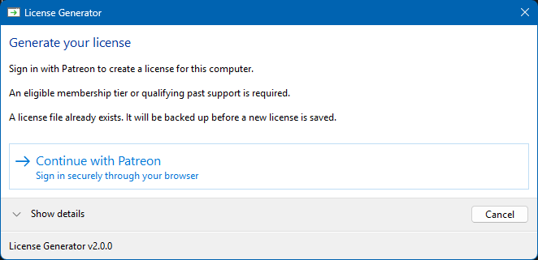
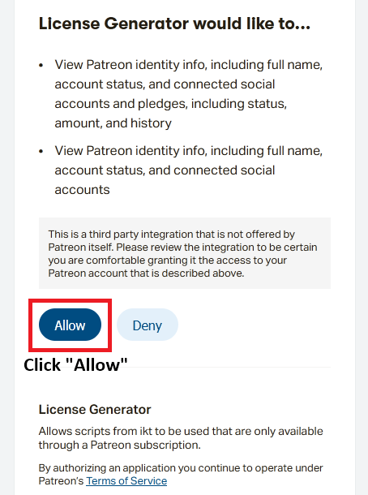
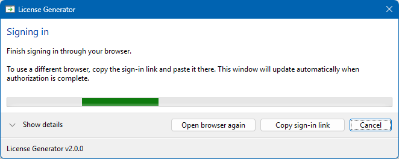
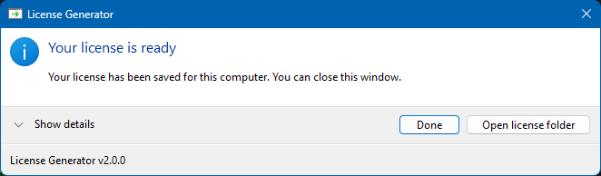

# License Generator

This application generates license files for your computer, which enables usage
of my programs (plugins, mods, scripts).

Eligibility is verified against Patreon - current and past subscribers to
[my Patreon](https://www.patreon.com/c/ikt/) using the "supporter" tier are eligible.

## What to expect

* License files are tied to the computer they're generated on. Licenses are not
  transferrable between computers.
* Multiple licenses may be generated for different computers using the same
  eligible Patreon account.
* License files may become incompatible as the computer configuration changes. In these cases,
  please re-generate the license by re-running this generator.
* Programs that require this license will automatically pick it up.
* This generator requires connection to Patreon to verify eligibility.
* License usage is checked locally/offline only, so no connectivity is needed after generating.

## Download

The License Generator tool is available and applicable for current and past subscribers
to my Patreon.

The latest License Generator is linked in the welcome note on
[your Patreon membership page](https://www.patreon.com/c/ikt/membership)
for my campaign.

Also listed in posts with
[the tag `license generator`](https://www.patreon.com/cw/ikt/posts?filters%5Btag%5D=license+generator).

## Usage

Before you start:

* Make sure the program/game running the plugin you want to activate is closed.
* Make sure Patreon.com can be reached from your computer.
* Make sure you have access to the Patreon account with the Supporter tier or had supported with this tier in the past.

### 1: Starting the application

Start `LicenseGenerator.exe`, then click **Continue with Patreon**. Your browser will open the Patreon authorization page.

  

If you already have a license, License Generator backs it up before saving a new one.

### 2: Authorizing License Generator on Patreon

Sign in with the account that subscribed to my Patreon, then authorize License Generator on Patreon.

  

If your browser doesn't open, click **Open browser again**.
If you're signed into the right account in another browser, click **Copy sign-in link** and paste it there.

  

### 3: Finalizing

Wait until License Generator says **Your license is ready**, then click **Done**.

The license file is saved as `%localappdata%\ikt\License\0.0.lic`.
**You don't need to do anything with this file**: programs/plugins will read it automatically when you start them.

  

Click **Open license folder** if you want to see the saved files. You can also find this button
during the other steps by expanding **Show details**.

### Console mode

If you prefer a console interface, run `LicenseGenerator.exe --cli`. It prints the sign-in link
and asks you to type `Y` to replace a recognized existing license or `N` to exit.
License Generator also falls back to console mode if it can't open the Windows interface.

## Troubleshooting

Check the [FAQ](https://oversteerengineering.com/faq#license-generator-troubleshooting) for things you can try if something goes wrong.

If you're still having trouble, you can [let me know](https://oversteerengineering.com/contact). Please include:

* `LicenseGenerator.log` and, if present, `0.0.lic` from the license folder.
* The log from the project you're having trouble with (for example, `Gears.log`), from that project's folder.

### Backups

Once you've checked that your license works, it's a good idea to back up `0.0.lic`.
To restore it, copy it back to `%localappdata%\ikt\License\`.
Changing core components or reinstalling Windows may mean you need to generate a new license.

If you lose the file or need a new license, run License Generator again.
Accounts which have supported in the past can let you do this without resubscribing, as long as Patreon still reports that support and the service is available.

For the Terms of Use, see [below](#terms-of-use).

## Changelog

### 2.0.0

* Allow past supporters to generate licenses
* Add a Windows interface with a console fallback

### 1.2.1

* Fix an issue with searching for subscription failing

### 1.2.0

* Use fallback ports if the ones the application wants to use are already in use by another application.
* Test basic Patreon connection before authorization to verify clear network access.

### 1.1.0

* Improve support for systems with switchable graphics.

### 1.0.1

* Fixed several issues relating to Patreon authorization and authentication failing.

### 1.0.0

* Initial release, creating license version "0.0".

## Terms of Use

This Software Use Agreement ("Agreement") sets out the terms between ikt ("Author") and the person obtaining access to and using the software described below ("User").

These are one-person projects developed in spare time. Support provides the access described for each offering.
Future development and personal assistance are at the Author's discretion.
Rights and responsibilities required by law still apply.

### 1. License to use the software

* **Scope and Access:**\
  Eligible membership or qualifying past support provides access to the projects described for that offering (“the Projects”). They are for personal, single-player, non-commercial use only. Commercial installations and paid public access are prohibited. Copyright remains with the Author; redistribution, resale and sublicensing are prohibited. All rights not expressly granted remain with the Author.

* **Grant of License:**\
  Eligible Users may use License Generator to create license files ("License") for the Author's software ("Software"). This is a limited, non-exclusive right of use. The User may activate multiple personal machines, with a separate License generated on each machine.

* **License Restrictions:**\
  A License is tied to the machine where it was generated. Sharing license files and bypassing, disabling or tampering with licensing mechanisms are prohibited. Unauthorized modification, reverse-engineering and redistribution are also prohibited, except where permitted by mandatory applicable law.

* **System Configuration Definition:**\
  Licenses use hardware and operating-system identifiers. Changes to core components or the operating system may require regeneration while eligible.

* **Affiliation Disclaimer:**\
  The Software is an independent creation and is not affiliated with, endorsed by, or associated in any way with the original developers of the applicable games. All content within this Software is the work of the Author and does not represent the views or work of Original Developer. All trademarks and copyrights are the property of their respective owners.

### 2. Subscription terms

* **Access to License Generator:**\
  License Generator checks the User's Patreon account for an eligible paid membership or qualifying past support.

* **Post-Subscription Access:**\
  Canceling a subscription leaves existing Licenses intact. Qualifying past support can also allow regeneration. Licenses have no scheduled expiry and remain tied to their system configuration and the software versions they cover.

### 3. As-is disclaimer

* **Software condition:**\
  The Software and License Generator are provided "as is" and may contain bugs. Supported environments and known limitations are described with each release. No extra guarantee is offered.

* **No Support Obligation:**\
  Development and assistance depend on the Author's available time and priorities. Subscriptions do not include on-demand work, release deadlines, guaranteed replies or individual troubleshooting. Game updates can break compatibility; support for later game builds is at the Author's discretion. Users should check release requirements before updating and keep their own backups.

* **Platform Compatibility:**\
  Supported platforms are x86-64 Windows PCs. Other platforms and compatibility layers, including Wine and Proton, are unsupported. Users are responsible for configuring their hardware and following its manufacturer's safety instructions.

* **No Endorsement for Online Use:**\
  Use is limited to single-player. GTA Online and third-party multiplayer mods are unsupported. Using game modifications online can lead to account penalties from the game operator.

### 4. Availability and online reliance

* **Reliance on Third-Party Services:**\
  Activation and downloads depend on Patreon and hosting services. Changes to their APIs, policies or availability can interrupt or end access. Activation uses the existing Patreon-based tool; manual activation and replacement infrastructure are outside this offering. Already generated licenses are checked locally.

* **Connection Issues:**\
  The User manages their network and VPN settings. License Generator itself must reach Patreon; a browser-only VPN covers the browser's requests. Network problems and Patreon outages can prevent generation.

### 5. Responsibility for damage

* **Use and losses:**\
  The User is responsible for their setup, backups and use of the Software. To the extent permitted by law, the Author is not liable for losses caused by misuse, unsupported configurations, third-party software or circumstances beyond the Author's reasonable control. Mandatory consumer rights remain unaffected.

* **Misuse:**\
  The User is responsible for losses caused by their unlawful misuse or unauthorized distribution of the Software, License Generator or License.

### 6. Intellectual property rights

* **Ownership:**\
  The Software, License Generator, and all related intellectual property rights belong to the Author. Eligibility grants a limited, non-exclusive right of use under this Agreement; no copyright ownership is transferred.
* **Original work:**\
  The Software is an original work of systems programming. It interacts with third-party software solely via volatile memory (RAM) and public API exports. It does not contain, reproduce, or distribute any proprietary code, assets, or binaries belonging to the Original Developer.

### 7. Termination

* **Termination of Access:**\
  Breaking these terms can end permission to access the Projects, community channels or assistance. Subscription cancellation is covered in section 2. Existing license files are not remotely deactivated when a subscription ends.

### 8. Renewal of licenses due to system configuration changes

* **License Renewal Requirement:**\
  When system changes invalidate a License, run License Generator again. Regeneration requires Patreon to confirm eligibility through an eligible membership or qualifying past support.

* **Upgraded License Requirements for New Versions:**\
  New major versions or different projects may have separate license or support requirements, described with that offering. These leave rights already granted for earlier versions intact. Future releases are at the Author's discretion.

### 9. Refunds and cancellation

* **Refunds:**\
  Refunds required by law remain available. Other refunds are at the Author's discretion and generally exclude changes of mind, unsupported setups, evaluation use and terms violations. Please check the documented requirements before subscribing.

  Refund processing follows [Patreon's current refund policy](https://support.patreon.com/hc/en-us/articles/205032045-Patreon-s-refund-policy) and the original payment method.

### 10. Community Standards and Support Access

* **Patronage relationship:**\
  Contributions support independent development and provide the access described for each offering. Development and assistance follow section 3.

* **Discretionary Support:**\
  The Author chooses which reports and requests to address and may decline assistance or further discussion. A previous reply or fix does not create an ongoing support arrangement.

* **Community Bans:**\
  Threats, harassment and repeated unwanted contact can result in bans and blocked contact. Bans remove access to community channels and discretionary assistance. The Author may decline contact and appeals. Evading a ban through other accounts or channels is prohibited. Restrictions on community access and discretionary assistance do not prevent the User from exercising statutory rights through appropriate channels.

### 11. Miscellaneous

* **Governing Law:**
  Dutch law governs this Agreement. Mandatory protections under other applicable laws still apply.

* **Severability:**
  If a clause is unenforceable, the remaining clauses continue to apply where legally possible.

* **Entire Agreement:**
  These terms and the benefits described for the relevant offering define the agreement. Suggestions and roadmap discussions describe possible future work.

* **Waiver:**
  Choosing not to enforce a term on one occasion does not waive it for future occasions. A waiver must be agreed in writing.

### 12. Modifications to this agreement

* **Right to Modify:**\
  Updated terms apply to future offerings and to existing arrangements only where the law permits. Rights already granted remain intact. Material changes affecting existing arrangements will be communicated with reasonable advance notice, where required. The [commit history](https://github.com/ikt32/scripts-updates/commits/master/licgen-readme.md) records edits.
